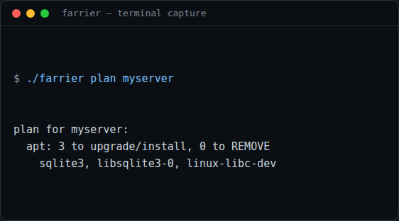
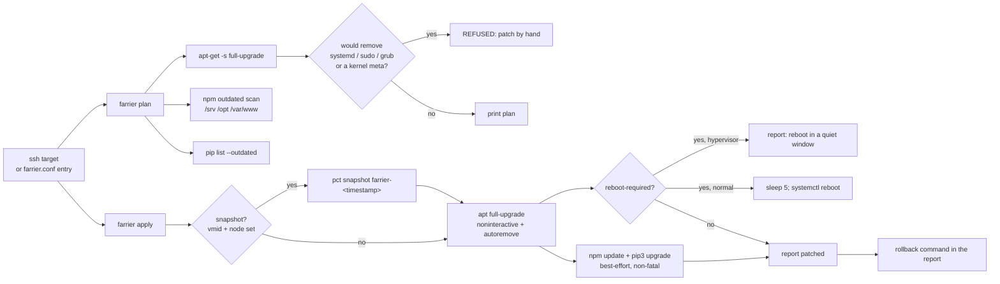

# farrier

**Owner-approved patching as a standalone CLI: `farrier plan` shows a dry-run over SSH, `farrier apply` snapshots, upgrades and reports before/after plus the rollback command.**


It never changes anything until you approve. `farrier` is the patcher extracted from [warden](https://github.com/casareanderson/warden): the same approve-first flow and the same hard rules, with no server needed.

 [](https://buymeacoffee.com/iamc_tech)

## What it does

- Shows a dry-run before touching anything: `farrier plan` runs `apt-get -s full-upgrade` (after an `apt-get update`), an `npm outdated` scan of every `package.json` under `/srv`, `/opt` and `/var/www`, and `pip list --outdated` over SSH, and prints what would change (`plan`, `plan_apt`, `plan_npm`, `plan_pip`).
- Refuses to remove critical packages: a plan that removes `systemd`, `openssh-server`, `sudo`, `grub`, `libc6`, a `linux-image` or a `proxmox-*`/`pve-*` kernel meta is reported as REFUSED (`NEVER_REMOVE`).
- Snapshots before applying: with `vmid` + `node` set, `apply` runs `pct snapshot <vmid> farrier-<timestamp>` first, and the report always carries the matching `pct rollback` command (`snapshot`, `apply`).
- Upgrades apt non-interactively and keeps your conffiles: `DEBIAN_FRONTEND=noninteractive` with `--force-confdef --force-confold`, then `autoremove --purge`.
- Handles the reboot itself: when `/var/run/reboot-required` appears it schedules `sleep 5; systemctl reboot` — but never on a host marked `hypervisor: true`, where it only warns.
- Treats npm and pip as best-effort: apt is the contract. A failing `npm update` or `pip3 install --upgrade` is reported in the result line, not fatal (`apply`).

## Screenshots / demo




## Quick start

Prerequisites: Python 3 (any modern version), an `ssh` client, and SSH key access to the boxes you patch. PyYAML is optional — a plain ssh string works without it.

```bash
git clone https://github.com/casareanderson/farrier.git
cd farrier
pip install pyyaml   # optional: only needed for named hosts in farrier.conf
./farrier -h
```

Success looks like the usage output in the screenshots above. Plan against a box with nothing configured:

```bash
./farrier plan root@192.0.2.10
```

## Usage

```bash
./farrier plan myserver            # dry-run: what would change
./farrier plan root@192.0.2.10     # bare ssh string, no config at all
./farrier apply myserver --yes     # snapshot, apply, report + rollback
./farrier apply mycontainer        # safe: prints the plan, asks for YES
```

`apply` keeps the approve-first flow: without `--yes` it prints the plan and waits for the literal word `YES`; anything else ends with "not applied." (`main`). Example output — the real plan from the screenshot:

```
plan for myserver:
  apt: 3 to upgrade/install, 0 to REMOVE
    sqlite3, libsqlite3-0, linux-libc-dev
```

npm and pip lines appear only when those scans find something. See [docs/EXAMPLES.md](docs/EXAMPLES.md) for a Proxmox LXC recipe and a nightly cron round.

## Configuration

`farrier` reads `farrier.conf` in the current directory, then `~/.config/farrier.conf` (first one found wins). A host is an SSH target; the YAML form is optional. [docs/SETUP.md](docs/SETUP.md) has the full setup.

| Key | Default | What it does |
|---|---|---|
| `ssh` | the host argument | SSH target, e.g. `root@192.0.2.10` |
| `sudo` | `false` | wrap each remote command in `sudo sh -c` |
| `vmid` | — | Proxmox container ID; enables snapshot + rollback |
| `node` | the `ssh` target | the Proxmox node that hosts the container |
| `hypervisor` | `false` | `true` = upgrade the box but never auto-reboot it |

Example (`farrier.conf.example`):

```yaml
hosts:
  myserver:
    ssh: root@192.0.2.10        # documentation IP
    sudo: false
    hypervisor: false
  mycontainer:
    ssh: root@192.0.2.11
    vmid: "101"
    node: pve@192.0.2.1
```

## How it works

`farrier` is one Python file. Every command opens a non-interactive SSH session (`ssh -o BatchMode=yes`, key auth) to the target; `sudo: true` wraps the remote command in `sudo sh -c`. `plan` only reads: an apt dry-run, an npm scan and a pip scan. `apply` snapshots first (when `vmid` is set), runs apt non-interactively, then npm and pip as best-effort, decides about the reboot and prints the rollback command.



Project structure:

```
farrier/
├── farrier                # CLI: plan/apply, snapshot, apt/npm/pip, reboot
├── farrier.conf.example   # named hosts: ssh, sudo, vmid, node, hypervisor
├── docs/
│   ├── SETUP.md           # ssh, snapshot + rollback, hypervisor safety
│   ├── EXAMPLES.md        # dry-run, apply, Proxmox LXC, cron recipe
│   ├── SAFETY.md          # the hard rules and why
│   ├── screenshot-plan.png   # real plan run (2026-11-09)
│   └── screenshot-help.png   # usage output (2026-11-09)
└── LICENSE                # AGPL-3.0
```

## Status, limits and real results

- Verified 2026-11-09: `./farrier -h` prints usage and exits 0. `./farrier plan myserver` over SSH against a live test target printed the plan above and exited 0 (apt simulate: 3 upgradable, 0 removals; no npm projects under `/srv`, `/opt`, `/var/www`).
- `apply` was not run in the test environment — it upgrades the target and may reboot it. The Proxmox snapshot/rollback path needs a real `vmid`/`node` and is unmeasured; the code is in `snapshot()` and `apply()`.
- The pip scan can silently report nothing: pip 24.0 (Debian, Python 3.12.3, 2026-11-09) rejects `pip list --outdated --format=freeze` — the combination errors with "List format 'freeze' cannot be used with the --outdated option" and `plan_pip` treats that as "nothing found". On pip versions where the combination works, the scan runs as written.
- SSH only, key auth: no agent, no daemon, no recurring scheduler. `apply` runs apt with a 90-minute SSH timeout, npm/pip with 15-minute timeouts.
- apt is the contract; npm and pip are best-effort. A failing npm or pip step is reported ("npm skipped …"), never fatal to the apt result.
- Physical hosts cannot be snapshotted: no `vmid` means no rollback, only the before/after report.
- Not a lock: the "one job at a time" rule in [docs/SAFETY.md](docs/SAFETY.md) documents intent, but the code has no lock file, so a second `apply` for the same target is not refused by `farrier` itself.
- It patches packages, not configuration: it will not migrate a broken service or fix a bad rebase.

## Licence and credits

AGPL-3.0-or-later (see [LICENSE](LICENSE)). `farrier` is the standalone version of the patcher inside [warden](https://github.com/casareanderson/warden); sibling tools in the same family: [sieve](https://github.com/casareanderson/sieve) (known-vulnerability scan), [proctor](https://github.com/casareanderson/proctor) (PR review) and [ephor](https://github.com/casareanderson/ephor) (AI-agent exposure).
